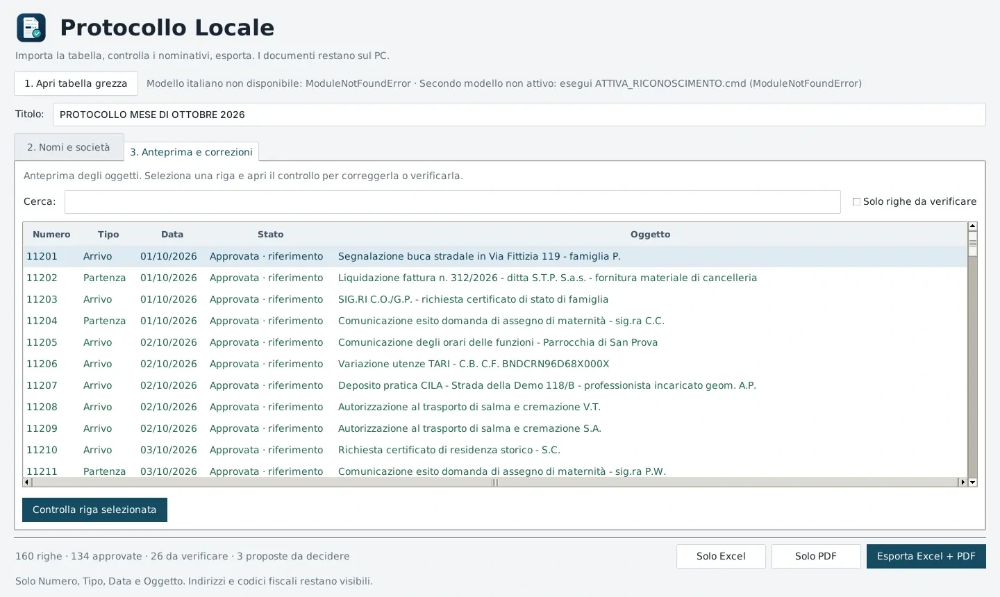
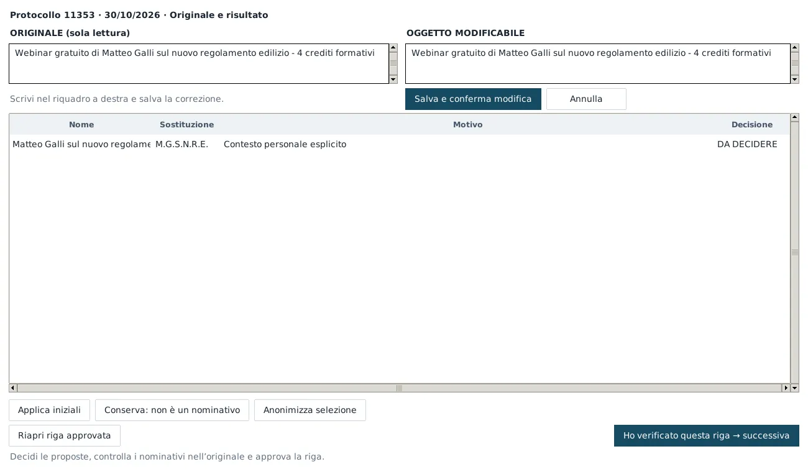
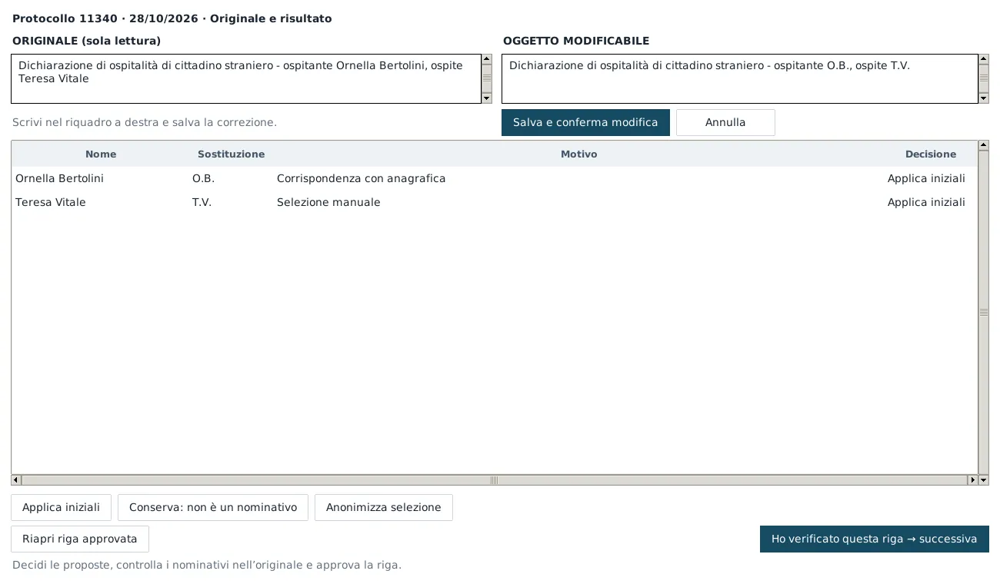
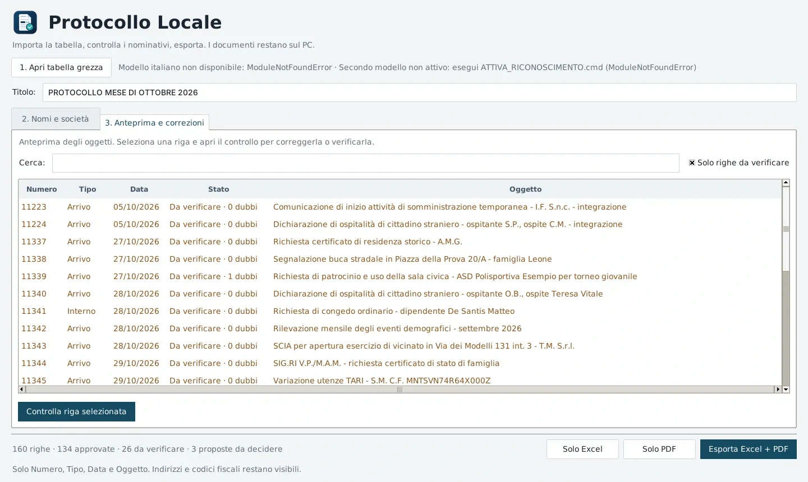

# Protocollo Locale

Prepara il registro di protocollo da condividere: propone le iniziali al posto dei nomi, riga per riga, e lascia ogni decisione a una persona.

> **Versione pubblica ripulita.** Codice, dati di prova, schermate e descrizioni sono stati controllati e ripuliti da dati sensibili: nomi, indirizzi, account, matricole, recapiti e credenziali sono inventati, e non ci sono riferimenti interni reali. Lo stemma dell'ente non è incluso.

| | |
|---|---|
| Categoria | Digitalizzazione |
| Contesto | Stage del 4° anno al Comune di Verolanuova |
| Stato | Realizzato durante lo stage |
| Tecnologie | Python, Tkinter, Excel, PDF |
| Demo | Inclusa, con dati inventati |

## Dal caos all'ordine

**Prima:** Un mese di registro con nomi da ridurre a iniziali, una riga alla volta.

**Dopo:** Un registro con le iniziali, controllato riga per riga prima dell'esportazione.

## Contesto

Il registro di protocollo elenca ogni documento ricevuto o inviato da un ente. Prima di condividerlo, nell'oggetto i nomi delle persone vanno ridotti a iniziali.

## Il problema

Farlo a mano su centinaia di righe al mese è lento e facile da sbagliare: un nome sfuggito resta leggibile, un'abbreviazione di troppo rende incomprensibile l'oggetto.

## La soluzione

Un'applicazione locale che legge l'esportazione del registro, ricava i nomi da mittenti e destinatari, riconosce contesti come «sig.» o «defunto» e le ragioni sociali, e propone le iniziali solo nella riga in cui compaiono. Ogni caso dubbio chiede una decisione. Le righe già approvate si riusano solo se numero, tipo, data e oggetto sono identici.

## Come funziona

1. Registro grezzo
2. Proposte di iniziali
3. Decisione per ogni caso
4. Approvazione della riga
5. Excel e PDF

## Funzioni principali

- Trova le colonne Numero, Tipo, Data e Oggetto in XLS, XLSX, CSV ed esportazioni HTML
- Nomi ricavati da mittenti e destinatari, anche in ordine inverso
- Contesti personali e ragioni sociali con forma giuridica
- Indirizzi ed enti pubblici lasciati invariati
- Selezione manuale di un nome sfuggito, valida solo in quella riga
- Riuso delle approvazioni solo su righe identiche
- Riparazione dei caratteri accentati letti male
- Esportazione bloccata finché resta una riga da controllare
- Riconoscitori di linguaggio facoltativi, eseguiti sul computer

## Casi inclusi nella demo

- 160 registrazioni inventate di un mese, con titolo sopra la tabella e riga di totale
- 134 righe già approvate e riusate, 26 da controllare
- Due righe corrette dopo l'approvazione: non vengono riusate
- Nomi che sfuggono e vanno selezionati a mano, associazioni da conservare
- Un file con un numero di protocollo ripetuto, che il programma rifiuta

## Privacy

- Documenti e nomi restano sul computer.
- Nella demo registro e riferimento approvato sono inventati.

## Limiti

- Non garantisce di trovare tutti i nomi: ogni riga nuova va controllata da una persona.
- Indirizzi e codici fiscali restano visibili, per scelta.
- Provato su un mese reale di registro; nessuna percentuale di accuratezza dichiarata.

## Schermate

Schermate della versione dimostrativa, con dati inventati.



_Registro di prova aperto: le righe già approvate vengono riusate._



_Una proposta troppo larga resta da decidere: la sceglie una persona._



_Un nome sfuggito, selezionato a mano: vale solo per quella riga._



_Solo le righe da verificare: finché ce ne sono, l'esportazione è bloccata._

## Provarlo

Windows: avvia `AVVIA.cmd` (può installare Python 3.12 da solo, serve Internet).

Linux o macOS, con Python 3.12 e Tk:

```bash
pip install -r requirements.txt
python3 interfaccia_v4.py
```

Premi «1. Apri tabella grezza» e scegli il registro in `Dati_di_prova`. Test: `python3 -m unittest`.

La demo pronta da scaricare, in un unico ZIP, è nella cartella [`demo/`](demo/).

**Verificato:** 67 test automatici superati. Registro di prova aperto nell'interfaccia su Linux: 134 righe riusate, esportazione bloccata finché restano righe da controllare.

**Non verificato:** AVVIA.cmd non provato su un PC Windows.

---

Parte del [portfolio dei progetti di stage](https://github.com/Shad272/portfolio) di Angelo Erik Scontrino.
